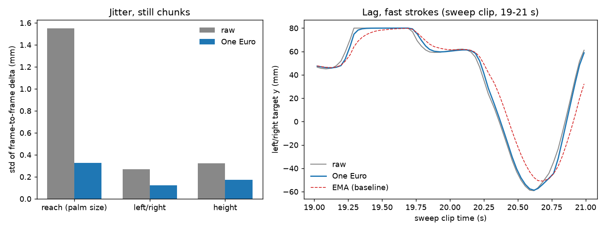

# V2-14: jitter and lag, with vs without the filter

Measured 2026-11-21 from `runs/filter/logs/*.csv` (written by `tools/filter_sweep.py --log` at commit 21ba954) by `tools/filter_eval.py`. No camera, no new filter code: every figure is computed from those logs and reproduces with
```
.venv\Scripts\python tools\filter_eval.py
```
Plot: `runs/filter/filter_eval.png` (left panel: jitter, right panel: lag on the fast strokes).

**Axis naming.** The log columns are `HandMapper`'s tuple positions, not image axes. Under mapping option A, `x` is reach, derived from palm size, so it is the noisy "depth" axis. `y` is left/right and `z` is height, both from image position. This doc labels them by role.

**Filter settings in the logs** (`config/gestures.yaml`, `filter:` at 21ba954): One Euro with min_cutoff 1.0 Hz / beta 0.05 on left/right and height, and 0.1 Hz / 0.001 on reach; `d_cutoff_hz` 1.0, `reset_after_s` 0.2. EMA reference: alpha 0.05 on reach, 0.3 on left/right and height. Input: the six clips in `runs/hands/` (1280x720, about 30 fps, one camera, recorded Nov 20), passed through `HandMapper` with a recording `smooth=` hook, so the raw series is exactly what the filter receives (mm, mirrored, mapped from the hand box, before work-box clamping).

---

## 1. Jitter (PROVISIONAL)

> **PROVISIONAL until there is a dedicated still-hand clip from the demo camera.**
> **The planned data didn't exist: no clip was held still.** The plan was to measure jitter on the palm, fist and thumbs_up clips with the hand held still. In the palm clip no 0.5 s chunk stays under 20 mm/s (0 of 18 chunks); fist has 2 of 15, thumbs_up 3 of 18. The hand moves throughout those clips.
> **Method used instead:** velocity-threshold still chunks cut out of all six clips. A chunk is 0.5 s in which a centred 5-frame mean of the raw left/right and height positions stays under 20 mm/s the whole way. Jitter is the standard deviation of frame-to-frame deltas inside those chunks, pooled. No delta crosses a chunk or a lost-hand gap.
> **Where the still data comes from:** of the 346 still frames, 255 (74%) are from the pinch clip (17 chunks), 45 from thumbs_up (3), 30 from fist (2), 16 from the sweep (1), none from palm or lost. It is one hand, one camera, one session.

| Axis (log column) | Raw σΔ | One Euro σΔ | One Euro / raw | EMA σΔ (reference) | Sample |
|---|---|---|---|---|---|
| **Reach**, from palm size (`x`) | 1.549 mm | 0.326 mm | 0.21 | 0.290 mm | 323 deltas, 23 still chunks (346 frames) |
| **Left/right** (`y`) | 0.267 mm | 0.124 mm | 0.46 | 0.135 mm | same |
| **Height** (`z`) | 0.324 mm | 0.173 mm | 0.53 | 0.174 mm | same |

σΔ is the standard deviation of frame-to-frame deltas, in mm.

**What this method could bias:**
- **It samples only calm moments.** Chunks are picked by low raw speed, so a hand in real use would jitter more than this.
- **Slow motion under 20 mm/s counts as jitter.** The filter passes slow motion through but removes noise, so this pushes the One Euro / raw ratio toward 1, which is conservative for the filter.
- **Stillness is judged on left/right and height only.** Real motion toward or away from the camera can sit inside a "still" chunk. The 0.1 Hz reach filter flattens that motion too, so the reach ratio could be flattered.
- **Lower variation is not accuracy.** There is no ground-truth position, so smoother output does not show the output is closer to the truth.
- **Reach is only as good as its stand-in depth.** V2-6 is not wired into the mapper on this branch, so the logs convert palm size to distance with a placeholder, `distance_cm = 10800 / palm_px` (wrist to middle knuckle), then to mm through `mapping.depth_cm` and `work_box.x`. The reach row will change with the calibrated depth and any narrower work box. The left/right and height rows don't depend on it.

**Sensitivity to the still rule.** With a looser 40 mm/s threshold, palm, fist and thumbs_up contribute 13, 13 and 12 chunks (68 chunks in all, 957 deltas). The One Euro / raw ratio becomes 0.25 for reach (2.049 → 0.508 mm), 0.66 for left/right (0.429 → 0.284 mm) and 0.71 for height (0.490 → 0.347 mm). The filter helps less when the hand is moving a little, so the 20 mm/s figures above are the strict case, and the looser rule shows how much they depend on the threshold.

---

## 2. Lag (separate: one sweep clip only)

> **Caveat: this rests on a single sweep clip, and a fast sweep is coming (Vyom is recording it).** The lag figure may change when it arrives; recompute then. The fast stretch in this clip is 100 frames (about 3 s) and has almost no fast reach motion (3 reach samples above 200 mm/s), so the reach lag here is essentially a slow-motion lag.

| Axis | Lag, One Euro (whole sweep clip) | Spread across sub-windows | Lag, EMA (reference) | Sample |
|---|---|---|---|---|
| **Reach** (`x`) | **210 ms** | 159–294 ms | 310 ms | 645 frames, 1 clip (666 visible; a 21-frame stretch is too short to correlate) |
| **Left/right** (`y`) | **13 ms** | 2–24 ms | 66 ms | same |
| **Height** (`z`) | **2.4 ms** | 1.5–26 ms | 43 ms | same |

**Method.** Lag is the peak of the cross-correlation between the raw and the filtered position. Each gap-free stretch (gaps up to 0.2 s) is resampled to a 5 ms grid and mean-removed; the stretches' correlations are length-weighted and summed; the peak is refined with a parabola. The 5 ms grid is the resolution, not an error bar. The only variation this data can show is the lag recomputed on sub-windows of the same clip:

| Window of the sweep clip | Frames | Reach | Left/right | Height |
|---|---|---|---|---|
| whole clip | 645 | 210.3 ms | 13.0 ms | 2.4 ms |
| slow strokes, 1–17 s | 480 | 294.0 | 23.5 | 25.8 |
| fast strokes, 19–23.5 s | 100 | 213.3 | 10.7 | 5.2 |
| first half, 0–11.9 s | 338 | 174.1 | 10.3 | 2.5 |
| second half, 11.9–24 s | 307 | 197.4 | 2.0 | 1.5 |
| gap-free stretch 0.7–18.2 s | 528 | 273.6 | 21.8 | 2.0 |
| gap-free stretch 18.5–22.3 s | 117 | 158.6 | 8.8 | 5.1 |

**Reading it.**
- **Quote reach lag as a range** (about 160–290 ms), not as 210 ms alone.
- **The whole-clip figure weights big movements most.** The least-squares shifts in `runs/filter/sweep.csv` (34 ms slow, 16 ms fast on the image axes) are a different method, pooled over all six clips and split by speed. The two sets are not interchangeable; compare within a method only.
- **The left/right trace saturates in the plot.** During the fast strokes the raw left/right target flattens at 80 mm (19.3–19.7 s): the hand was outside the mapper's hand box, so the mapped position sits at the box edge. Lag can't be read off flat stretches, only off the transitions.
- **No confidence intervals.** With a handful of continuous stretches in one clip, a bootstrap would mostly show how few independent samples there are.


